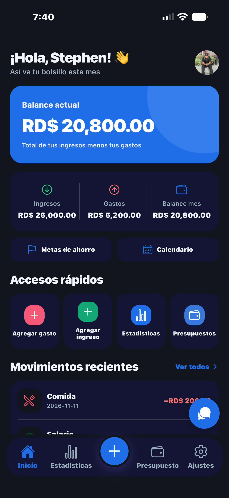
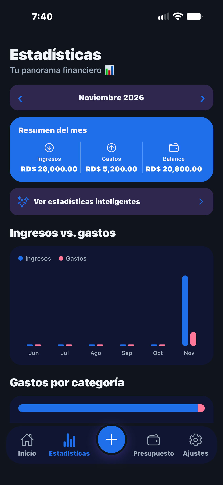
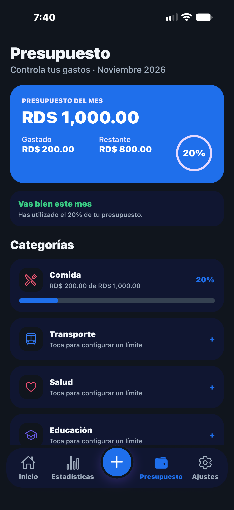
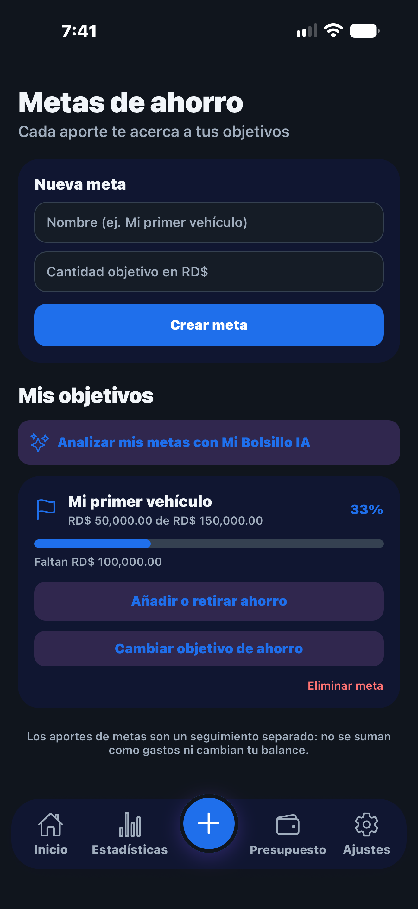
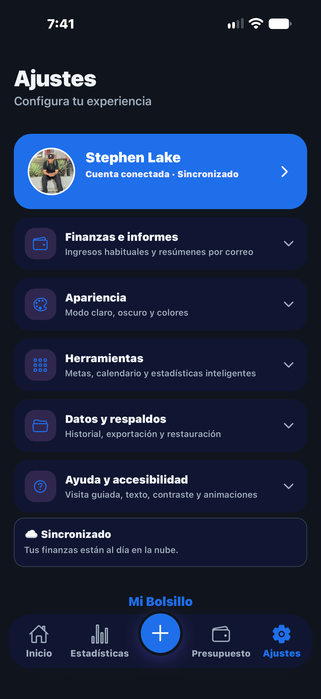

# 📱 Mi Bolsillo — Finanzas personales

Aplicación móvil desarrollada como proyecto personal, orientada al registro y análisis de finanzas personales. **En desarrollo y pruebas.**

## Tecnologías

`React Native` · `Expo` · `JavaScript` · `SQLite` · `Supabase`

## Funcionalidades

- Registro y consulta de ingresos, gastos y movimientos recientes.
- Panel de inicio con balance y accesos rápidos.
- Estadísticas, gráficos y resúmenes mensuales.
- Presupuestos por categorías y seguimiento del gasto.
- Creación y seguimiento de metas de ahorro.
- Personalización del aspecto, herramientas y accesibilidad.
- Funciones de sincronización y análisis financiero en desarrollo.

## Capturas de pantalla

Todas las imágenes siguientes corresponden a pantallas de la aplicación.

| Inicio | Estadísticas | Presupuesto |
|:---:|:---:|:---:|
|  |  |  |

| Metas de ahorro | Ajustes |
|:---:|:---:|
|  |  |

## Rol en el proyecto

Diseño de interfaces, implementación de funcionalidades, manejo de almacenamiento local, integración de servicios y pruebas en Android y iOS.

## Código fuente

El código completo de la app no forma parte de este portafolio público mientras se revisan los controles de privacidad, autenticación y aislamiento de datos. Esta presentación muestra funciones y capturas, no certifica que la aplicación esté lista para producción.
