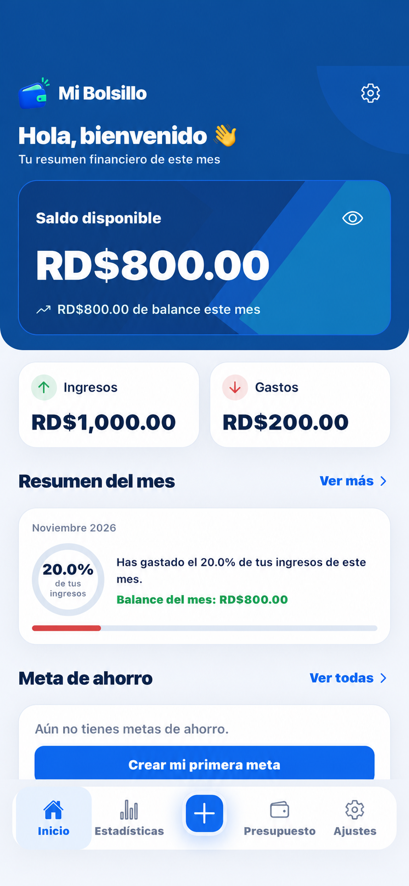
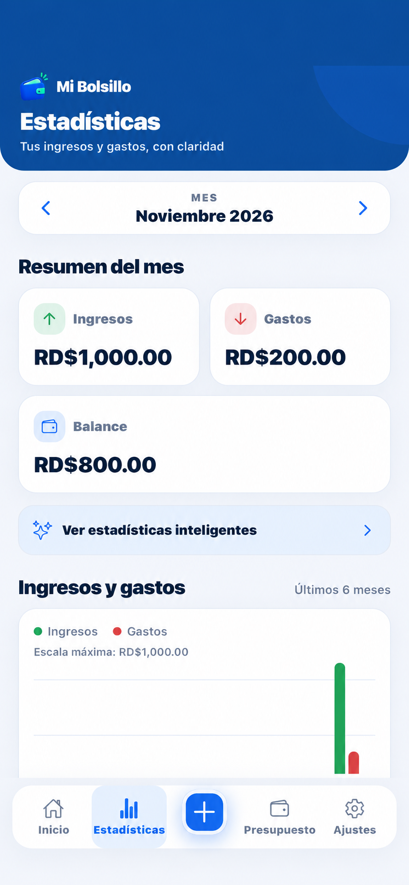
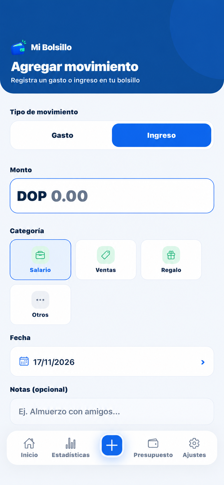
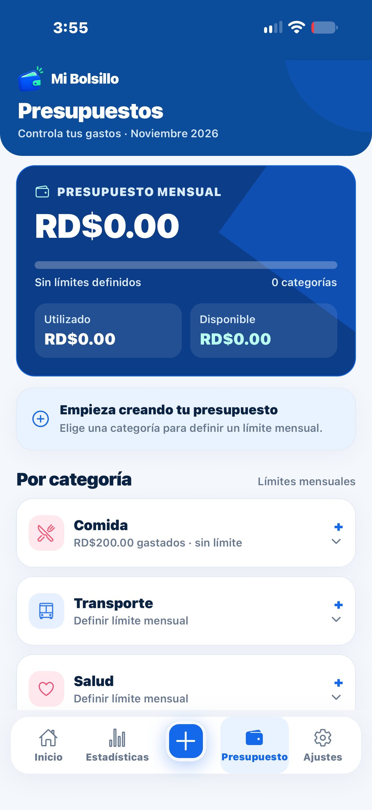
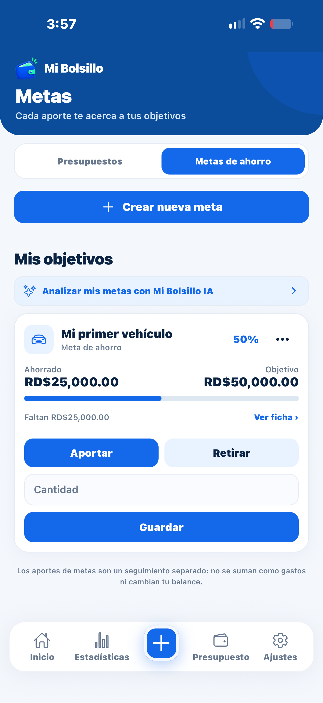
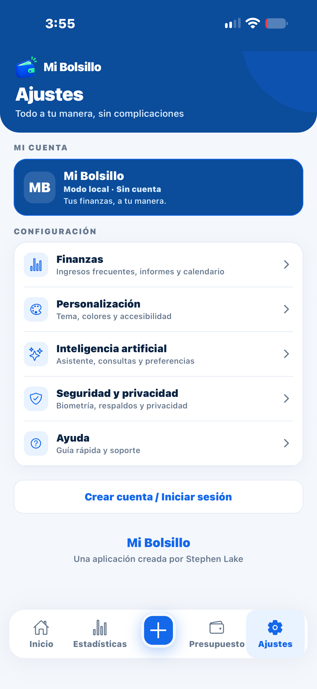

# 📱 Mi Bolsillo — Aplicación móvil de finanzas personales

**Proyecto personal | React Native · Expo · JavaScript · Supabase · SQLite**  
**Estado:** en desarrollo y pruebas en Android/iOS. **No publicada como versión de producción.**

## ¿Qué es Mi Bolsillo?

Mi Bolsillo es una aplicación móvil que empecé por iniciativa propia para facilitar el control de las finanzas personales. Permite registrar ingresos y gastos, consultar balances y estadísticas, establecer presupuestos por categoría y organizar metas de ahorro desde una interfaz clara y personalizable.

Mi objetivo al crearla no fue solo diseñar pantallas: también implementar flujos completos, manejar estados y datos, integrar servicios y aprender a detectar y corregir fallos durante pruebas reales.

## Funcionalidades que muestro

- **Inicio y resumen financiero:** saldo, ingresos, gastos y balance del período.
- **Registro de movimientos:** ingreso o gasto con monto, categoría, fecha y notas.
- **Estadísticas:** resúmenes mensuales y gráficos de evolución de ingresos y gastos.
- **Presupuestos:** límites mensuales por categoría y seguimiento del gasto.
- **Metas de ahorro:** creación, progreso, aportes y retiros registrados.
- **Configuración y personalización:** temas, preferencias, accesibilidad, cuenta y ayuda.
- **Gestión de datos:** almacenamiento local e integración con Supabase; los flujos de cuenta, sincronización, seguridad y funciones de IA siguen sujetos a pruebas y mejoras según versión.

## Capturas actuales — noviembre de 2026

Las siguientes son capturas de la interfaz renovada. Las imágenes de los apartados de ingreso y gasto muestran las dos modalidades del formulario.

| Inicio | Estadísticas | Agregar ingreso |
|:---:|:---:|:---:|
|  |  |  |

| Presupuestos | Metas de ahorro | Ajustes |
|:---:|:---:|:---:|
|  |  |  |

**Vista complementaria:** [Agregar gasto](imagenes/agregar-movimiento-gasto.png)

## Mi participación técnica

Desarrollé el proyecto como iniciativa personal: diseño de experiencia móvil, implementación de componentes, lógica de ingresos y gastos, persistencia, integración con servicios y pruebas funcionales. Entre las comprobaciones realizadas se encuentran registro de movimientos, separación de datos de invitado y usuario, autenticación y comportamiento sin conexión.

### Tecnologías

`React Native` · `Expo` · `JavaScript` · `Supabase` · `SQLite` · `Git` · `GitHub`

## Lo que he aprendido

Este proyecto me ha permitido practicar desarrollo móvil de extremo a extremo, mantener una interfaz coherente entre pantallas, depurar errores, organizar el almacenamiento de información y mejorar la aplicación a partir de pruebas. También he aprendido a dar prioridad a la privacidad y a no publicar código que todavía se está revisando.

## Estado del código

El código fuente completo de Mi Bolsillo **no es público por ahora**. Estoy revisando aspectos de autenticación, permisos, sincronización y separación de datos antes de tomar decisiones de publicación. Este repositorio comparte el proyecto y capturas reales; no representa una certificación de seguridad ni disponibilidad comercial.

[← Volver al portafolio principal](../README.md)
