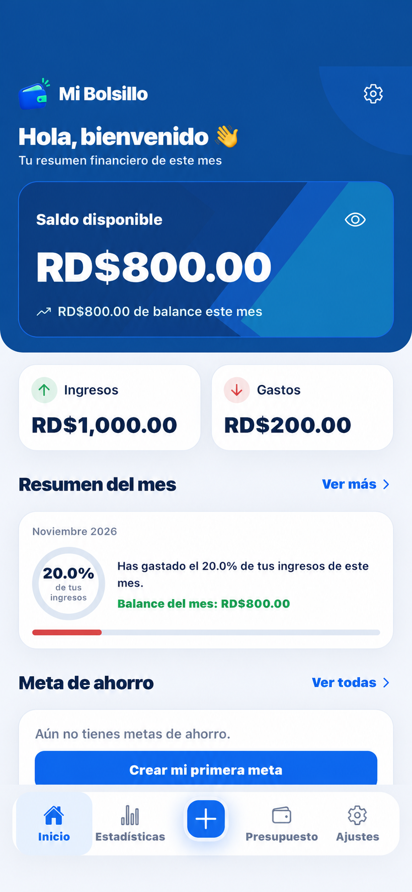
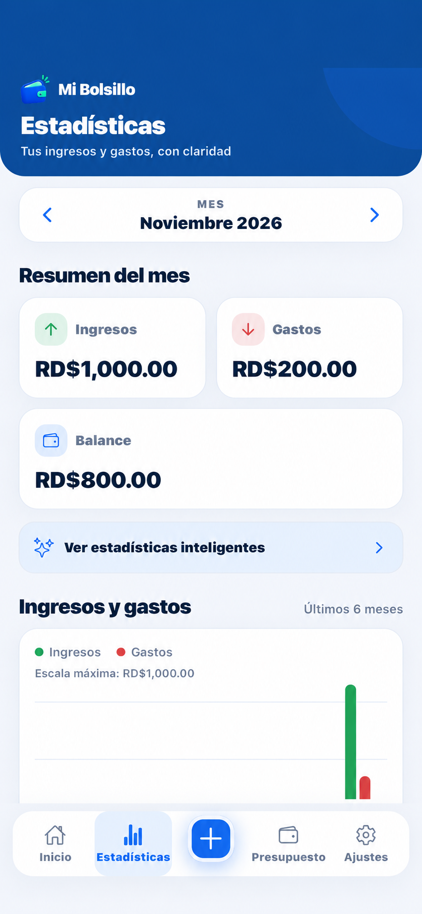
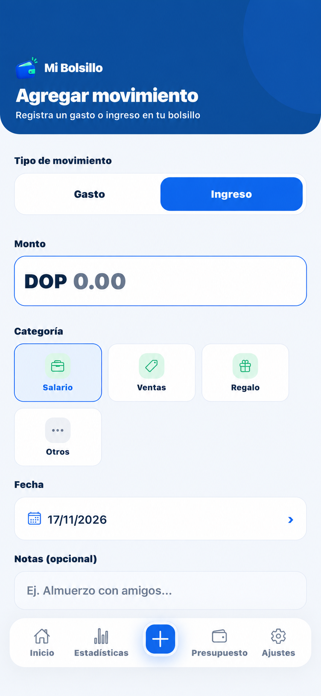
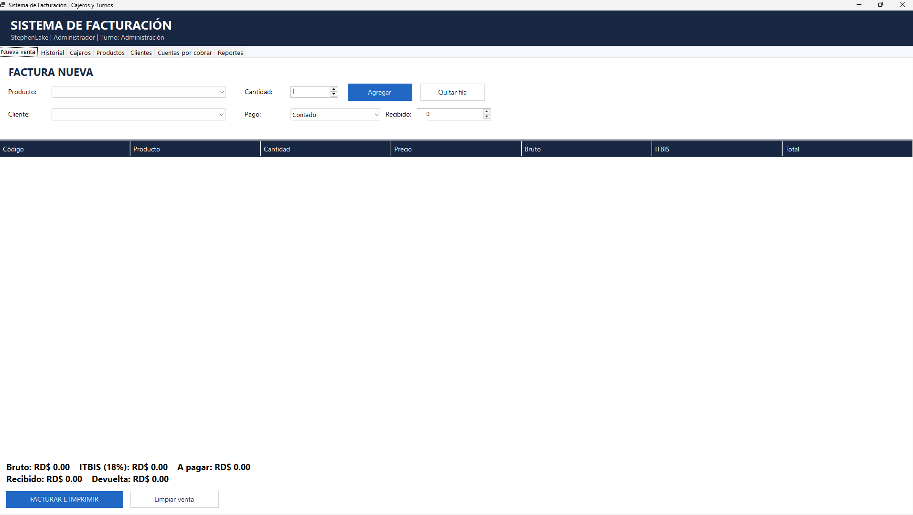
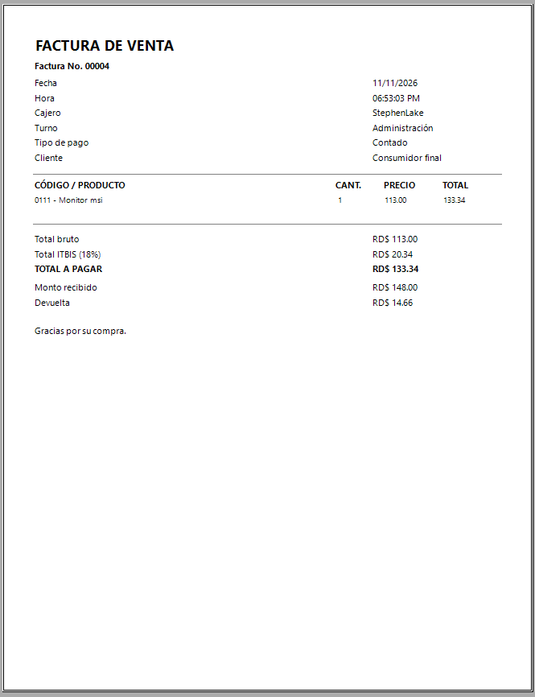
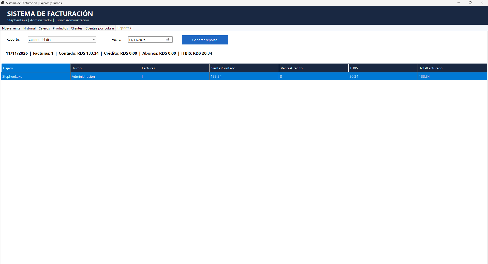

# Geovani Stephen Lake Duran 👋
**Desarrollador de Software Junior | React Native · C# · .NET · SQL Server · QA**

Estudiante de **Ingeniería en Software en UNICDA** y técnico en Desarrollo y Administración de Aplicaciones Informáticas. Me gusta construir soluciones que resuelvan problemas reales, probarlas en dispositivos y mejorarlas a partir de los resultados.

📍 República Dominicana · [LinkedIn](https://www.linkedin.com/in/geovani-stephen-lake-duran-58b41b450) · [Correo](mailto:stephenlakeduran@gmail.com)

## 🚀 Proyectos destacados

### 📱 [Mi Bolsillo — Aplicación móvil de finanzas personales](Mi-Bolsillo/)
**Proyecto personal en desarrollo y pruebas | React Native, Expo, JavaScript, Supabase y SQLite**

Mi Bolsillo permite registrar ingresos y gastos, visualizar estadísticas, configurar presupuestos por categoría y dar seguimiento a metas de ahorro. También he trabajado en la experiencia de usuario, la persistencia de datos, la autenticación y las pruebas de flujos móviles.

| Inicio | Estadísticas | Registrar ingresos |
|:---:|:---:|:---:|
|  |  |  |

**[Ver todas las capturas, funcionalidades y decisiones técnicas de Mi Bolsillo →](Mi-Bolsillo/README.md)**

> El código fuente completo de Mi Bolsillo se mantiene privado mientras el proyecto continúa en desarrollo y se revisan sus controles de seguridad. Las capturas son de la versión de noviembre de 2026.

### 🧾 [Sistema de Facturación — Aplicación de escritorio](Sistema-Facturacion/)
**Proyecto académico | C#, Windows Forms, .NET 8, Entity Framework Core y SQL Server**

Aplicación para gestionar ventas, facturas, usuarios y reportes de caja. Incluye autenticación para usuarios, operaciones de facturación y acceso a datos relacionales. Su código está disponible para revisión.

| Nueva venta | Factura generada | Reporte del día |
|:---:|:---:|:---:|
|  |  |  |

**[Explorar el proyecto y su código fuente →](Sistema-Facturacion/README.md)**

## 🛠️ Tecnologías y herramientas
- **Desarrollo móvil:** React Native, Expo, JavaScript.
- **Desarrollo de escritorio:** C#, .NET, Windows Forms, programación orientada a objetos.
- **Datos:** SQL Server, PostgreSQL, SQLite, Supabase.
- **Pruebas y colaboración:** pruebas funcionales, Postman, Jira, Git y GitHub.

## 🎓 Formación y experiencia
- **Ingeniería en Software**, Universidad Domínico-Americana (UNICDA), en curso.
- **Técnico en Desarrollo y Administración de Aplicaciones Informáticas**, Politécnico Colegio Nuestra Señora del Perpetuo Socorro FARD.
- **CESAC:** prácticas relacionadas con redes y administración de sistemas.
- **AMOV International Teleservices:** atención y servicio al cliente.

## 🎯 Lo que busco
Oportunidades junior para desarrollar aplicaciones móviles y software, colaborar en productos reales y continuar aprendiendo buenas prácticas de ingeniería y calidad.

**[Contactar por correo](mailto:stephenlakeduran@gmail.com) · [Ver LinkedIn](https://www.linkedin.com/in/geovani-stephen-lake-duran-58b41b450)**
