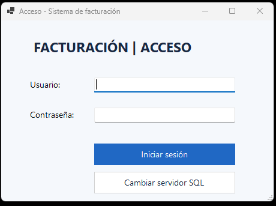
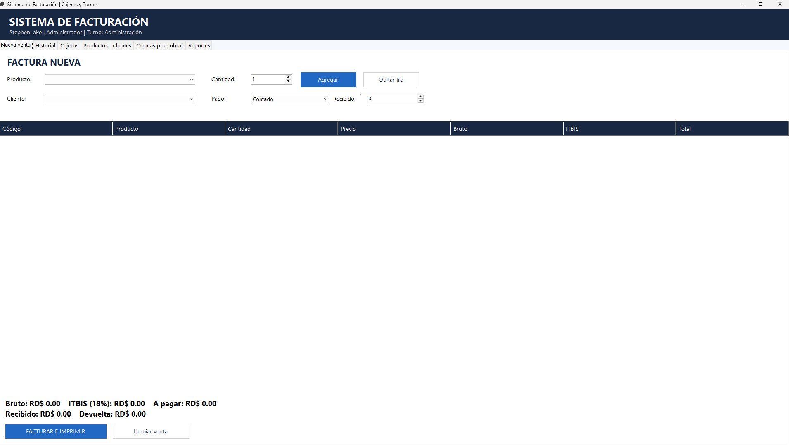
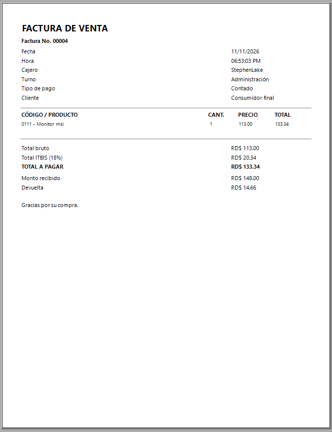
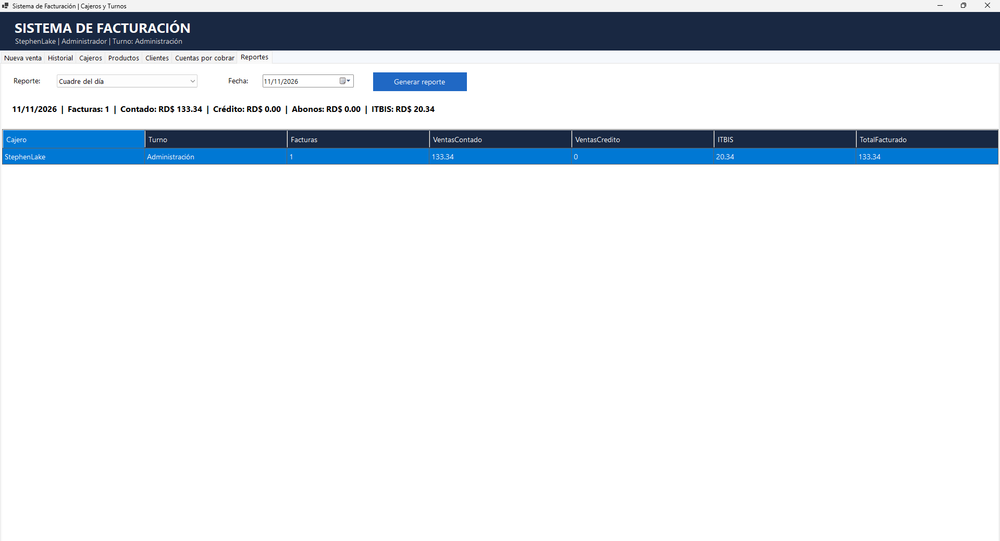

# 🧾 Sistema de Facturación — Aplicación de escritorio

**Proyecto académico · Windows · C# · Windows Forms · .NET 8 · Entity Framework Core · SQL Server**

Sistema de escritorio para registrar ventas, administrar información de facturación y generar comprobantes y reportes.

## Funciones principales

- Inicio de sesión de administrador y cajeros.
- Gestión de productos, clientes y usuarios.
- Registro de ventas al contado o a crédito.
- Cálculo de subtotal, ITBIS, total y cambio a devolver.
- Generación, impresión y consulta de facturas.
- Reportes de ventas y cuadre del día.

## Capturas reales de la aplicación

### 1. Acceso al sistema

### 2. Nueva venta

### 3. Factura generada

### 4. Reporte / cuadre del día

## Estructura del código

- [`Forms/`](codigo-fuente/Forms/) — interfaz de usuario.
- [`Services/`](codigo-fuente/Services/) — operaciones, cálculos y seguridad.
- [`Data/`](codigo-fuente/Data/) — base de datos y persistencia.
- [`Models/`](codigo-fuente/Models/) — entidades.

> **Nota:** código de una versión académica archivada. No se ha recompilado ni probado como parte de esta preparación del portafolio. Los datos mostrados en las capturas son para demostración.
